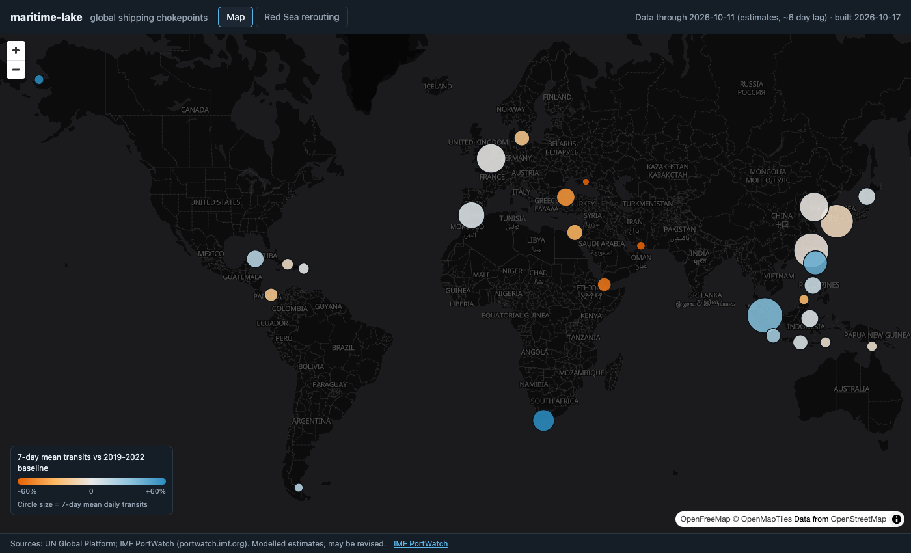
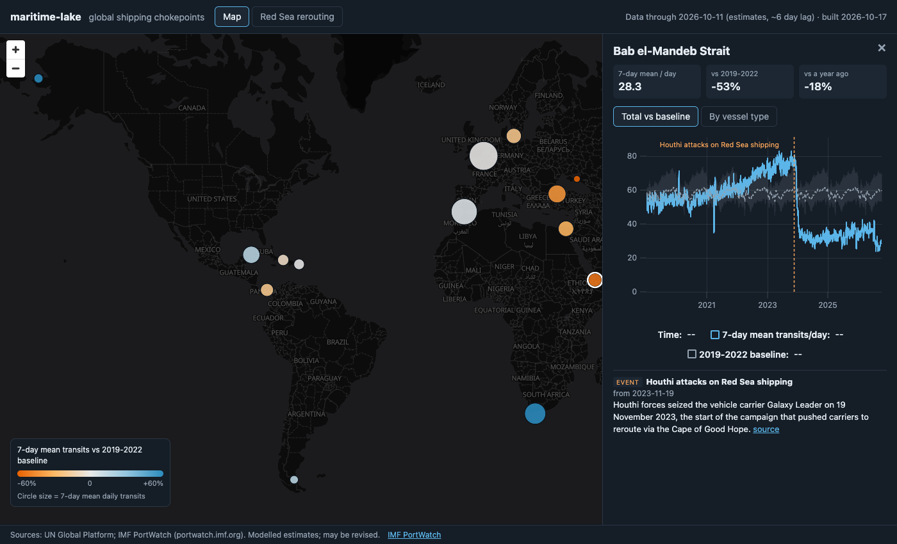
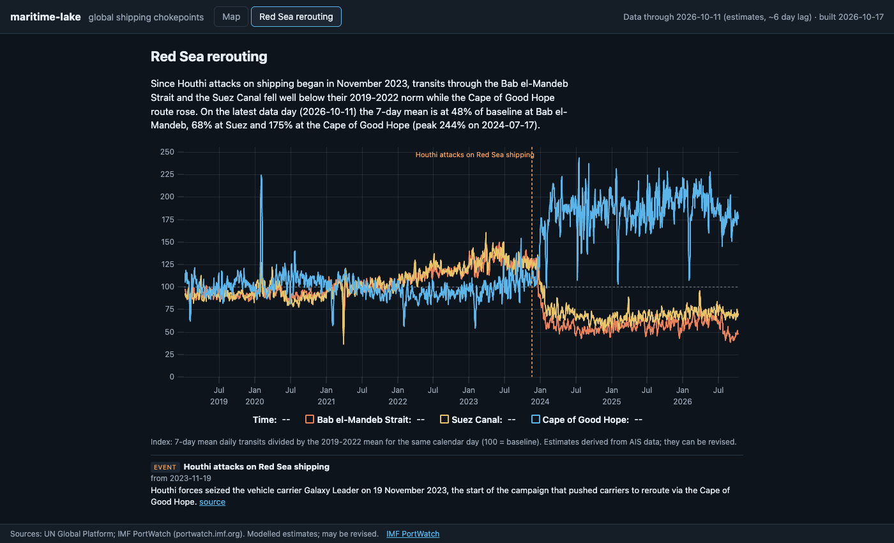
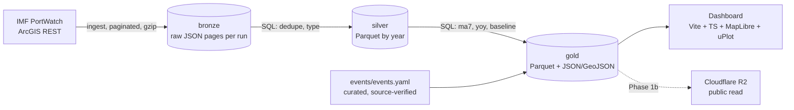

# maritime-lake

An open, reproducible data lakehouse for global shipping chokepoints, with a public dashboard as its front page.

The main deliverable is the **pipeline**, not the map: clone the repo, run one command, and you rebuild the same
tables from the public source. Derived Parquet files can be queried directly with DuckDB.

The dashboard's hook is **disruption impact**: how traffic shifted when something happened (for example the Red Sea
attacks: Bab el-Mandeb and Suez down, Cape of Good Hope up).



| Chokepoint panel | Red Sea rerouting story |
|---|---|
|  |  |

Other dashboards publish charts but not the code. This repo publishes the code, the data model and the derived data.

## Quickstart

Requirements: [uv](https://docs.astral.sh/uv/) and Node 20+.

```bash
uv run mlake all              # ingest + build + check (first run: full load, ~100 s for ~80k rows)
cd web && npm install && npm run dev
```

Individual steps: `uv run mlake ingest [--full]`, `uv run mlake build`, `uv run mlake check`. Tests: `uv run pytest`.
The first run is a full load; later runs re-fetch the trailing 30 days and upsert them (values are modelled
estimates and get revised). `npm run build` writes `web/dist/` and copies `data/gold` into `dist/data`.

## Architecture



Batch work is Python + DuckDB on purpose: it is the lingua franca of the target audience, and every model is a
readable SQL file in [`pipeline/sql/`](pipeline/sql). Serving and (Phase 2) realtime stay on Cloudflare Workers.

```
pipeline/mlake/   ingest.py build.py check.py models.py cli.py
pipeline/sql/     silver_*.sql gold_*.sql  (one model per file)
events/events.yaml
tests/            pytest on a synthetic fixture
web/              Vite + TypeScript dashboard
data/             gitignored: bronze/ silver/ gold/ state/
```

## Data sources and attribution

Fetched from the IMF PortWatch ArcGIS FeatureServer (no key; `maxRecordCount` 1000, paginated):

| Source | Rows (2026-10-17) | Use |
|---|---|---|
| `Daily_Chokepoints_Data` | 79,548 | daily transits and estimated trade volume, 28 chokepoints since 2019-01-01 |
| `PortWatch_chokepoints_database` | 28 | chokepoint dimension (name, lat, lon) |
| `portwatch_disruptions_database` | 132 | natural-disaster events (TC/EQ/FL...), not geopolitical |

Data lags about six days. Values are modelled estimates derived from AIS data and can be revised.

**Required attribution** (PortWatch dataset page, "How to Cite"): "Sources: UN Global Platform; IMF PortWatch (portwatch.imf.org)."
The dashboard footer and `gold/meta.json` carry this line.

### Terms of use (checked 2026-10-17)

The PortWatch datasets name `https://www.imf.org/external/terms.htm` as their licence, which resolves to
[IMF Copyright and Terms](https://www.imf.org/en/About/copyright-and-terms). Relevant points, quoted:

- "Users may download, extract, copy, create derivative works, publish, distribute, and use Data obtained from IMF Sites subject to these conditions: Distributed or reproduced Data must appear accurately with attribution to the IMF as the source ..."
- "Users shall not infringe upon the integrity of the Data and shall refrain from any act of alteration of the Data that intentionally affects its nature or accuracy. If material transformation occurs, it must be stated explicitly along with the required source citation." (gold tables are derived: moving averages, baselines and ratios; they are labelled as such)
- "For any potential commercial reuse of IMF Data, email copyright@imf.org to request permission."
- "The IMF prohibits bulk download of information by automated technology without explicit permission and reserves the right to terminate access to its Sites or Content."
- "For material not attributed to the IMF, users should obtain permission directly from the respective third-party copyright holder." (the underlying AIS data comes from the UN Global Platform / Spire)

What this means here: redistribution of derived data with attribution is allowed; this project is non-commercial.
Two open points to resolve **before publishing the Parquet files on a public bucket (Phase 1b)**: (1) whether the daily
automated pull of ~80k rows via the ArcGIS API counts as "bulk download by automated technology" (the pipeline is
sequential, identifies itself with a User-Agent and re-fetches only a 30-day window after the first load; ask the
PortWatch team / copyright@imf.org for explicit permission); (2) the third-party AIS provenance. This is not legal advice.

## Data model

- **bronze**: `data/bronze/<source>/run=<UTC ts>/page-NNNN.json.gz`, the raw API pages, one directory per run.
- **silver** `chokepoint_daily` (Parquet, hive-partitioned by `year`): typed, one row per `(portid, date)`.
  The latest bronze run wins, which implements the trailing-window upsert. Also `dim_chokepoint.parquet`, `disruptions.parquet`.
- **gold** `chokepoint_daily`: silver plus
  - `ma7_total`, `ma7_capacity`: trailing 7-day mean (NULL until 7 days are available),
  - `yoy_pct`: `ma7_total` vs the same calendar date one year earlier,
  - `baseline_ma7`: mean `ma7_total` for the same month-day over 2019-2022 (Feb 29 looks up Feb 28 and is not used to build the baseline),
    with `baseline_lo` / `baseline_hi` as the min/max band,
  - `vs_baseline_pct`.
- **gold** `chokepoint_latest`, `chokepoints.geojson`, `series/<portid>.json`, `events.json`, `meta.json` feed the dashboard.

Data-quality checks (`mlake check`, non-zero exit on failure): no duplicate keys, no missing dates per chokepoint,
`n_total` = sum of the five vessel-type counts and `n_cargo` = sum of the four non-tanker counts (both verified to hold
on all 79,548 rows), `capacity` = sum of type capacities within +/-5 t (components are rounded independently in the
source; verified max difference 4 t), no nulls, 28 chokepoints, a common end date, and the silver row count never
shrinking between builds.

### Curated events

`events/events.yaml` holds geopolitical events PortWatch's table lacks. An event is listed only if its dates were
verified by fetching its `source_url`; `date_basis` records which sentence they come from.

## Query the data with DuckDB

```sql
-- after `uv run mlake all`; once published, replace the path with the public HTTPS URL
SELECT date, ma7_total, baseline_ma7, round(vs_baseline_pct, 1) AS vs_baseline_pct
FROM 'data/gold/chokepoint_daily.parquet'
WHERE portname = 'Suez Canal' AND date >= '2023-10-01'
ORDER BY date
LIMIT 10;
```

## Roadmap

Phase 1 (this): local pipeline, dashboard. Phase 1b: R2 upload and public bucket, deploy the web Worker, ports table.
Phase 2: live AIS around selected chokepoints via a Durable Object relay. See [DESIGN.md](DESIGN.md).

## Licence

Code: MIT (see [LICENSE](LICENSE)). Data: see the IMF PortWatch terms above.
